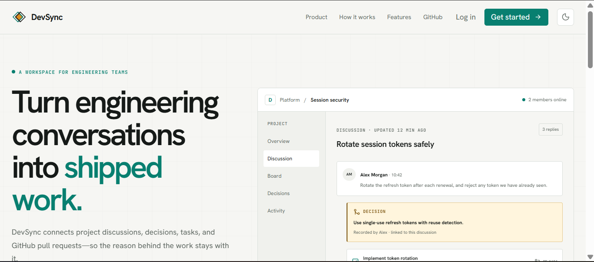
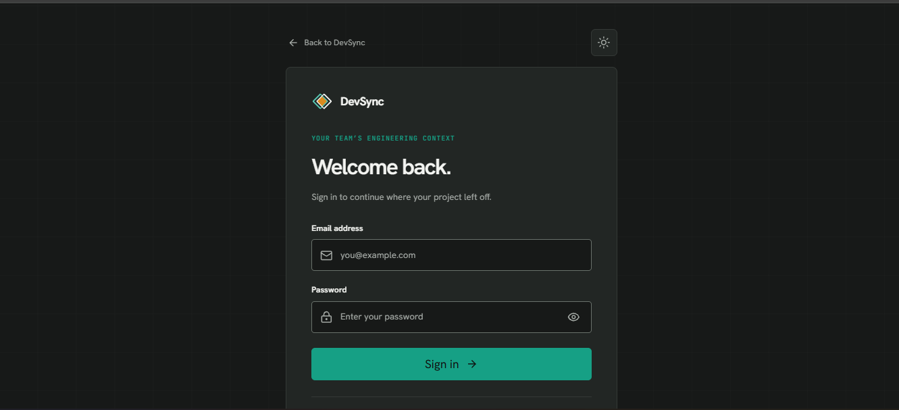
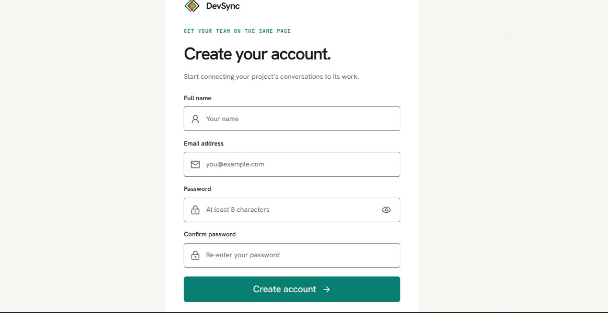
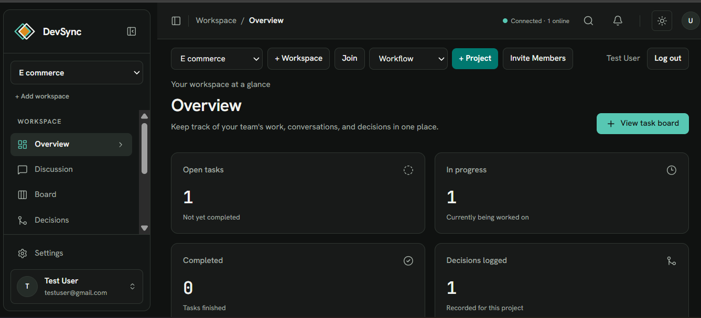
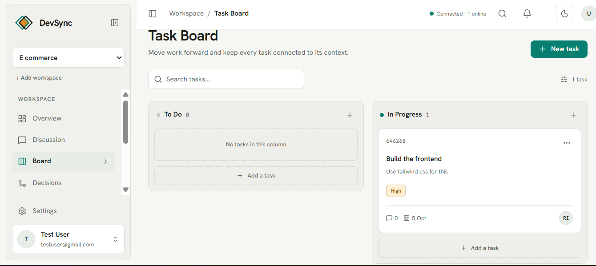
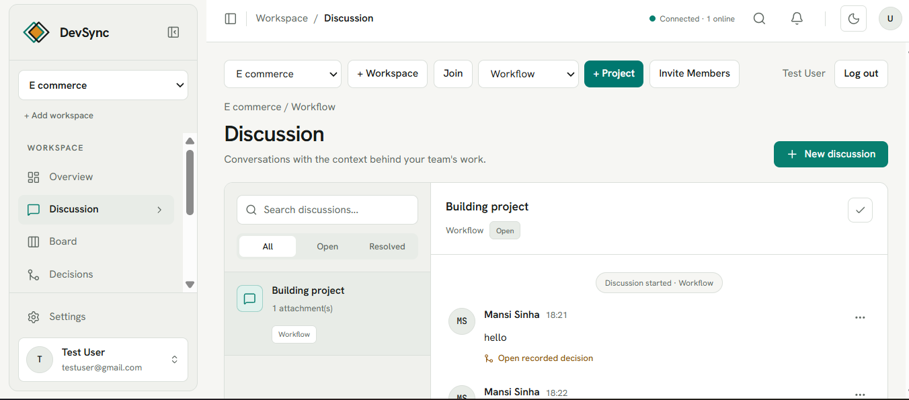
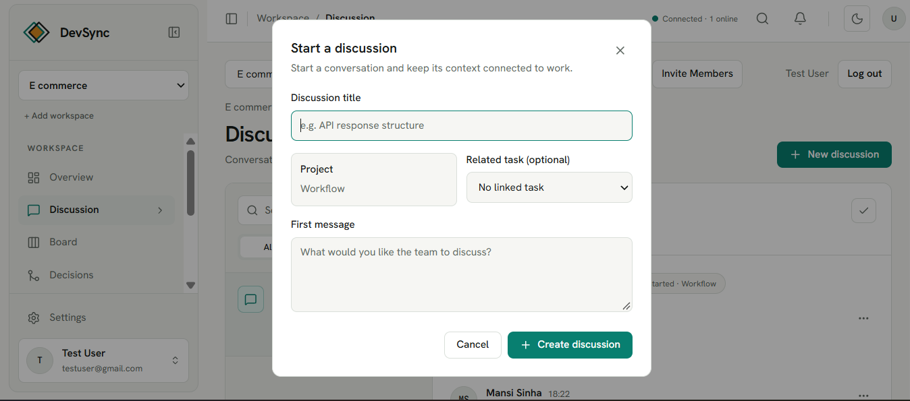
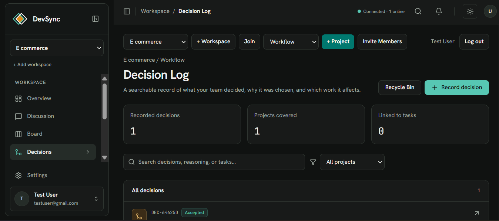
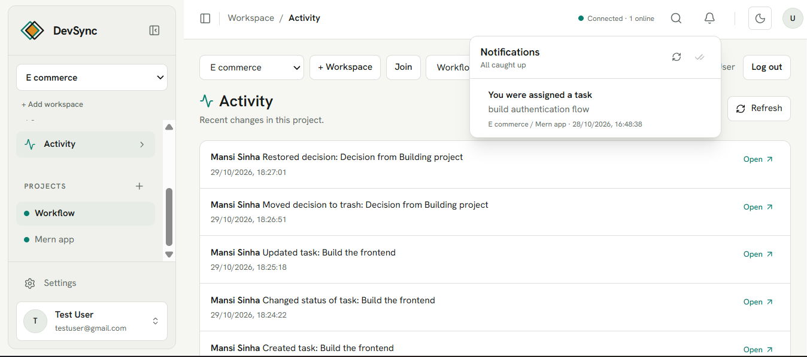

# DevSync

### A Real-Time Collaborative Engineering Workspace

**From conversation to decision, from decision to execution.**

DevSync is a full-stack collaborative workspace designed to help development teams organize projects, manage tasks, communicate, document decisions, and stay aligned throughout the development lifecycle.

Instead of scattering important project information across multiple tools, DevSync brings discussions, decisions, task management, and team activity into one connected workspace.

Built with **React, Node.js, Express.js, MongoDB, and Socket.IO**.

---

## Preview



## The Idea Behind DevSync

In software development, tasks rarely exist in isolation. They usually begin with a conversation, evolve through team discussions, and eventually become decisions that need to be implemented.

However, the context behind those decisions can easily get lost.

DevSync aims to make that process more organized:

**Conversation → Decision → Task → Execution**

The goal is to provide a shared engineering workspace where team members can understand not just what needs to be done, but also the discussions and decisions surrounding their work.

---

## Features

### 1. Authentication and User Management

- User registration and login.
- Protected application routes.
- Authenticated workspace access.
- User profile and account management.

| Login | Registration |
|---|---|
|  |  |

### 2. Workspace Overview

A centralized dashboard for monitoring project information and keeping track of team activity.

- Workspace and project overview.
- Task statistics.
- Recent activity.
- Quick access to important workspace information.



### 3. Task Management

Organize development work through a structured task workflow.

- Create, update, and delete tasks.
- Manage task priorities and statuses.
- Track tasks across different workflow stages.
- Search and organize project tasks.
- Maintain task-related context.



### 4. Team Discussions

Keep project conversations organized within the workspace.

- Project discussions.
- Team communication.
- Discussion creation.
- File attachments with upload validation.
- Contextual collaboration around engineering work.



**Starting a discussion**



### 5. Decision Management

Document important engineering decisions so that project context remains accessible.

- Record project decisions.
- Maintain a structured decision log.
- Preserve information relevant to team planning and execution.



### 6. Activity Tracking

Keep track of important events taking place across the workspace.

- Project activity history.
- Visibility into relevant workspace updates.
- Better awareness of ongoing team collaboration.



### 7. Real-Time Collaboration

DevSync uses Socket.IO to support real-time communication between connected clients.

This helps users stay informed about relevant workspace events without relying entirely on manual page refreshes.

### 8. Workspace Collaboration and Permissions

- Workspace and project organization.
- Member invitations.
- Role-based access control.
- Admin and Member permissions.
- Resource-level authorization.

### 9. GitHub Integration

Backend support for connecting development activity with project workflows, including GitHub pull-request references and webhook processing.

**Note:** Live GitHub webhook delivery has not yet been verified in a production deployment.

---

## Technology Stack

| Layer | Technologies |
|---|---|
| Frontend | React, Vite, JavaScript |
| Styling | CSS, Tailwind CSS |
| Backend | Node.js, Express.js |
| Database | MongoDB, Mongoose |
| Real-time communication | Socket.IO |
| Authentication | JWT-based authentication |
| Version control | Git, GitHub |
| API testing | Node.js test runner |

---

## Project Architecture

DevSync follows a client-server architecture.

```text
                       DevSync
                          |
             +------------+------------+
             |                         |
       React Frontend             Express Backend
             |                         |
       User Interface              REST APIs
             |                         |
       API Integration          Business Logic
             |                         |
             +--------- Socket.IO -----+
                                       |
                                    MongoDB
```

### Project Structure

```text
DevSync/
|
|-- client/
|   |-- public/
|   |-- src/
|   |   |-- components/
|   |   |-- pages/
|   |   |-- services/
|   |   |-- App.jsx
|   |   `-- index.css
|   `-- package.json
|
|-- server/
|   |-- src/
|   |   |-- config/
|   |   |-- middleware/
|   |   |-- models/
|   |   |-- routes/
|   |   |-- services/
|   |   |-- utils/
|   |   `-- server.js
|   |-- test/
|   `-- package.json
|
|-- Screenshots/
|   |-- LandingPage.png
|   |-- LoginPage.png
|   |-- RegisterPage.png
|   |-- Overview.png
|   |-- TaskBoard.png
|   |-- Discussion.png
|   |-- StartDiscussion.png
|   |-- Decision.png
|   `-- Activity.png
|
|-- .gitignore
`-- README.md
```

---

## Getting Started

Follow these steps to run DevSync locally.

### Prerequisites

Make sure you have the following installed:

- Node.js and npm
- Git
- MongoDB Atlas account or an accessible MongoDB instance

### 1. Clone the Repository

```bash
git clone https://github.com/mansi0sinha/DevSync.git
cd DevSync
```

### 2. Backend Setup

Navigate to the server directory:

```bash
cd server
npm install
```

Create a `.env` file using `server/.env.example` as the reference.

Configure the required environment variables, including your MongoDB connection string and authentication secret.

Never commit your actual `.env` file or credentials.

Start the backend:

```bash
npm run dev
```

The API runs locally at:

```text
http://localhost:5000
```

### 3. Frontend Setup

Open a second terminal and navigate to the client directory:

```bash
cd client
npm install
```

Configure the frontend environment using the provided environment examples where applicable.

Start the frontend:

```bash
npm run dev
```

Open:

```text
http://localhost:5173
```

---

## Testing and Quality

DevSync includes automated tests covering important application behaviour, including:

- Authentication and authorization.
- Workspace permissions.
- Invitation acceptance.
- Task workflow and deletion.
- Notification access control.
- Upload security.
- GitHub webhook signature verification.
- Resource deletion and data integrity.
- Runtime configuration.

### Run Backend Tests

```bash
cd server
node --test
```

### Run Frontend Checks

```bash
cd client
npm test
npm run lint
npm run build
```

The project has undergone automated API and component-level verification. Full browser end-to-end coverage and live production webhook testing remain future validation tasks.

---

## Security Considerations

DevSync implements multiple application-level safeguards, including:

- Protected API routes.
- Role-based authorization.
- Resource-level permission checks.
- Input validation.
- File-upload restrictions.
- Notification access scoping.
- GitHub webhook signature verification.
- Environment-based secret configuration.

Security-sensitive configuration should always remain outside version control.

---

## Future Improvements

Potential next steps include:

- Expanded browser end-to-end testing.
- Production deployment and monitoring.
- Live GitHub webhook integration testing.
- Additional performance and scalability improvements.
- Enhanced activity and notification management.

---

## Project Status

**Actively developed — functional full-stack application.**

Core collaboration features have been implemented and tested locally. Additional production-level validation and deployment improvements are planned.

---

## Author

**Mansi Sinha**

Full-Stack Developer

[GitHub](https://github.com/mansi0sinha)

---

If you find DevSync interesting, consider giving the repository a star!

**DevSync — Keep the conversation. Preserve the decision. Move the work forward.**